<p align="center">
  
</p>

<p align="center">
  
</p>

<p align="center">
  <a href="https://www.linkedin.com/in/doha-mounazil-531704212/"></a>
  
  
  
</p>

## About me

```python
doha = {
    "now":        "MSc, Data Analytics & AI · Ibn Zohr University",
    "before":     ["Licence d'excellence, Data Analytics & AI · FS Agadir",
                   "DUT, Computer Engineering · EST Safi"],
    "experience": ["IT support & SQL Server administration",
                   "datacenter internship (VMware ESXi, servers)",
                   "two web apps built during internships"],
    "languages":  ["English", "French", "Arabic"],
    "off_screen": ["sport", "travel"],
}
# Ask me about: SQL that actually performs, clean dashboards, and why my model is overfitting
```

## How I got here

<p align="center">
  
</p>

## Toolbox

<p align="center">
  
</p>

## Projects

| Project | What it does | Stack |
|---|---|---|
| [**llm-service-orchestration**](https://github.com/Doha-Mnzl/llm-service-orchestration) | Team MSc project (Distributed Systems): an LLM reads a request in plain language and decides which services to call (sales, inventory, catalog, analysis). Nothing is saved without human approval. 🚧 in progress | FastAPI · RabbitMQ · Docker · LLM |
| **powerbi-dashboard** *(coming soon)* | Interactive dashboard on a public dataset | Power BI · DAX |
| **sql-analysis** *(coming soon)* | Business questions answered in SQL, queries explained | SQL Server · MySQL |
| **ml-notebook** *(coming soon)* | One clean, explained model, from data to evaluation | Python · scikit-learn |

## Certifications

- **CCNA1** · Cisco
- **Encryption** · Internet Society Learning

## Learning board

| Now | Next | Later |
|---|---|---|
| Distributed systems (MSc project) | Machine learning in practice | LLM apps and agents |
| Power BI and DAX | Data storytelling | MLOps basics |

## Activity

<p align="center">
  
</p>

<picture>
  <source media="(prefers-color-scheme: dark)" srcset="https://raw.githubusercontent.com/Doha-Mnzl/Doha-Mnzl/output/github-snake-dark.svg">
  <source media="(prefers-color-scheme: light)" srcset="https://raw.githubusercontent.com/Doha-Mnzl/Doha-Mnzl/output/github-snake.svg">
  
</picture>

<details>
<summary>🇫🇷 <b>En français</b></summary>
<br>

Étudiante en Master Analytique des Données et Intelligence Artificielle à l'Université Ibn Zohr. Expérience en support technique, administration SQL Server et datacenter. Je construis des tableaux de bord Power BI, des analyses SQL et des modèles en Python.

</details>

<details>
<summary>🧪 <b>Easter egg: my confusion matrix</b></summary>
<br>

| | predicted: yes | predicted: no |
|---|---|---|
| **coffee needed** | ✅ always | 0 |
| **query runs first try** | rarely | ✅ after an index |

</details>

<p align="center"><sub>Clean data, clear answers. Thanks for visiting ✨</sub></p>
